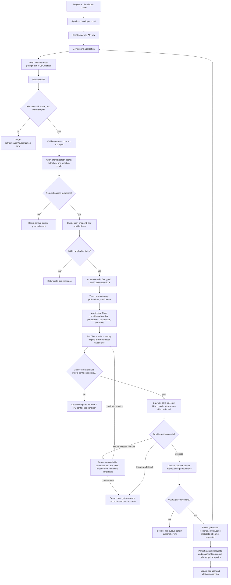
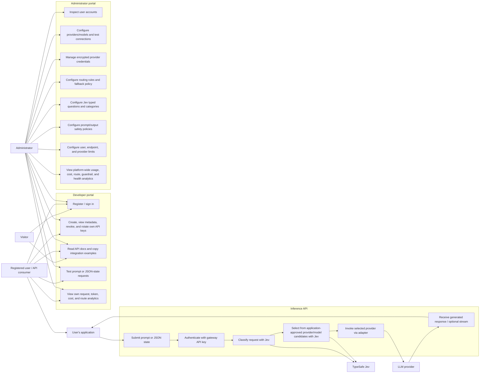

# Target User Roles, API Flow, and Use Cases

This document describes the intended end state after the planned chapters are
implemented. The product is an API-first inference gateway: users integrate it
into their own applications using gateway API keys. The web portal supports
account management, API-key management, integration guidance, and
administration; it is not primarily a chat application.

## Actors and target access

| Actor | Target functionality and access |
| --- | --- |
| Visitor (not signed in) | Register or sign in; view public service-health information and product/API documentation. No inference calls, private request analytics, API keys, or configuration access. |
| Registered user / API consumer (`USER`) | Create, list, revoke, and rotate their own gateway API keys; copy integration examples and test requests in a portal playground; call the public inference API using plain-text prompts or structured JSON state; receive generated responses, optionally streamed; view their own request, token, cost, provider/model, and routing analytics. Requests are subject to their preferences, guardrails, and limits. They cannot view another user's data or administer shared providers/configuration. |
| Administrator (`ADMIN`) | All registered-user capabilities, plus inspect user accounts and platform-wide usage; configure shared providers/models and encrypted provider credentials; test provider connections; configure routing rules, Jev questions/categories, guardrails, and rate limits; view platform-wide requests, token/cost, provider/model, route/fallback, guardrail, limit, and system-health analytics. |
| API client (user's application) | Send authenticated inference requests to the gateway and consume the gateway response. It uses a user-owned gateway API key and never needs direct access to provider credentials. |
| TypeSafe Jev (decision model via internal AI service) | Evaluate prompt or JSON state against typed questions; return classifications and probabilities/confidence where supported; choose among provider/model candidates already approved by application rules. Jev returns structured decisions, not the generated user response. |
| LLM provider (external system) | Receive a server-to-server request through a provider adapter using administrator-managed credentials; return the generated response and provider usage metadata. It is not directly exposed to the API client. |

## Target authorization and key principles

- A user signs into the portal with their account. Programmatic inference
  requests authenticate separately with a gateway API key.
- Gateway keys belong to one user and can be listed by safe metadata, revoked,
  and rotated by that user. The raw key is displayed only once at creation;
  only a non-recoverable verifier is stored. Keys are never logged.
- Gateway API keys are not LLM provider credentials. Provider credentials are
  managed by administrators, stored encrypted, used only server-side, and
  never returned to users.
- Each request is authorized and attributed to the key's owning user. Users
  can access only their own keys, request analytics, and any optional
  conversation/context records.
- Request content retention is a product/privacy policy to define. Usage
  analytics should work from request metadata without requiring indefinite
  storage of raw prompts or provider responses.
- Admin-only operations cover shared provider/model/credential settings,
  Jev decision configuration, global routing and guardrail rules, configurable
  limits, user oversight, and platform-wide analytics.
- Jev may select only from candidates the application has determined to be
  eligible. The application validates Jev's typed choice and applies
  confidence, safety, availability, and fallback policies.
- The gateway calls the selected provider and returns its response; it does
  not redirect API clients to providers or disclose provider credentials.

## Target API request flow

The proposed public endpoint is `POST /v1/inference`. The final path and
request/response contract will be defined during implementation. The input is
either a text prompt or structured JSON state, for example:

```http
POST /v1/inference
Authorization: Bearer <gateway-api-key>
Content-Type: application/json
```

```json
{
  "input": "Summarize the key risks in this report."
}
```

```json
{
  "input": {
    "task": "extract_fields",
    "document": {
      "invoice_number": "INV-104",
      "amount": 248.5,
      "currency": "USD"
    }
  }
}
```

The payload is submitted to the gateway, not directly to Jev or an LLM provider.
The gateway/AI service supplies the state and configured typed questions to
Jev, then routes the request and returns the selected provider's response.



## Target use-case diagram



## Roadmap mapping

- Provider adapters, streaming, and error handling: Chapter 3.
- Encrypted provider credentials and connection testing: Chapter 4.
- Public inference endpoint, prompt/JSON request and response contracts,
  gateway API-key lifecycle, request persistence, integration examples, and
  optional context identifiers: Chapter 5.
- Jev integration, typed classification questions, category probabilities and
  confidence, and configurable categories: Chapter 6.
- User preferences and deterministic candidate eligibility, followed by Jev
  Choice route selection, validation, confidence policy, capability checks,
  provider limits, and fallback re-selection: Chapter 7.
- Input/output validation, prompt safety, secret detection, and guardrail
  events: Chapter 8.
- Configurable user, API-key, provider, and endpoint rate limits: Chapter 9.
- Token/cost accounting and personal/admin analytics APIs: Chapter 10.
- API-key portal, request playground, integration docs, user request dashboard,
  and admin configuration/analytics dashboards: Chapter 11.
- Platform-wide request, API-key, usage, provider/model, cost, route/fallback,
  guardrail, limit, and health analytics: Chapter 12.
