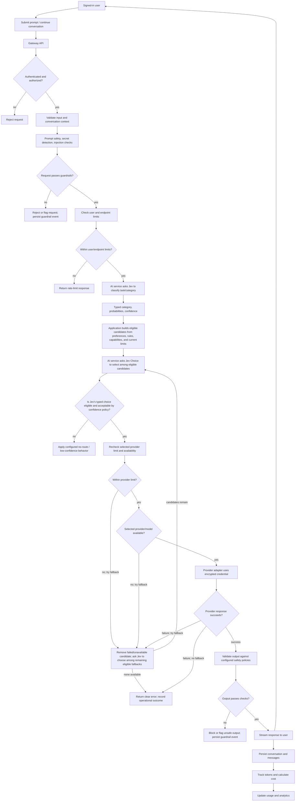
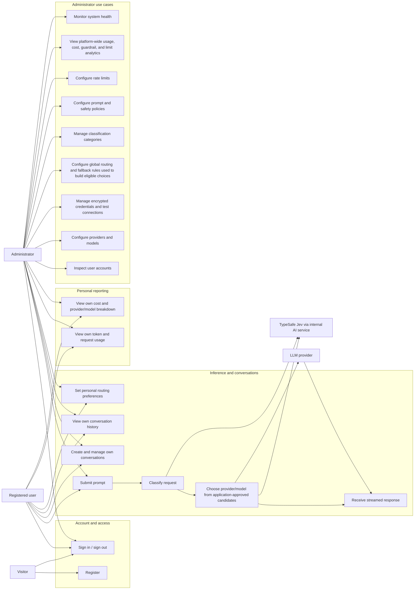

# Target User Roles, Access, and Use Cases

This is the intended end-state view of the application after the planned
chapters are implemented. It is a product-level target, not a statement that
these capabilities are available today. The actors and capabilities below are
based on the project roadmap in [TODO.md](../TODO.md).

## Actors and target access

| Actor | Target functionality and access |
| --- | --- |
| Visitor (not signed in) | Register or sign in; view the public service-health page. No prompt submission, account data, or analytics access. |
| Registered user (`USER`) | Submit prompts and receive streamed model responses; create and manage their own conversations and history; set routing preferences (such as primary and fallback providers); view their own token, cost, model/provider, and request usage analytics. Guardrails and user rate limits apply to their requests. Users can only access their own conversations and usage. |
| Administrator (`ADMIN`) | All registered-user capabilities, plus configure providers, models, encrypted provider credentials, and connection tests; configure routing rules, custom classification categories, prompt/safety flags, and rate limits; view platform-wide user, token, cost, provider/model, guardrail, rate-limit, and system-health analytics; inspect user accounts. Administrative changes and sensitive credentials are restricted to this role. |
| LLM provider (external system) | Receive gateway requests through provider adapters using server-managed credentials; return streamed or complete model responses and provider usage metadata. A provider is an integration, not an interactive application user. |
| TypeSafe Jev (decision model, accessed through the internal AI service) | Return typed request-category decisions and select a provider/model from the eligible candidates supplied by the gateway. Jev also returns probabilities and confidence for supported question types. It does not generate the user's response or override application policy. |

### Target authorization principles

- Sign-in is required for prompt submission, conversation history, user
  preferences, and personal analytics.
- Users may access and change their own conversations and preferences, and view
  their own usage and costs. They cannot access another user's data or platform
  configuration.
- Administrator-only operations cover shared provider/model/credential
  configuration, global routing and guardrail settings, configurable limits,
  user/account oversight, and platform-wide analytics.
- Provider credentials are stored encrypted, used by the server-side adapter,
  and never exposed to users or returned in plaintext. Secrets must not appear
  in logs.
- All inference requests pass through validation, safety checks, configured
  limits, and routing. A rejected or rate-limited request does not proceed to a
  provider.
- Jev can choose only from candidates already deemed eligible by application
  rules. The application validates its typed choice and applies the configured
  confidence and fallback policy.

## End-to-end target request flow

## Target use-case diagram

## Roadmap mapping

- Provider adapters, streaming, and error handling: Chapter 3.
- Encrypted provider credentials and connection testing: Chapter 4.
- Conversations, messages, context, and history: Chapter 5.
- Jev integration, typed prompt classification, category probabilities and
  confidence, and custom categories: Chapter 6.
- Personal preferences and deterministic eligibility filtering, followed by
  Jev Choice selection, validated typed routing results, confidence policy,
  provider/model capability checks, and fallback re-selection: Chapter 7.
- Input/output validation, prompt safety, secret detection, and guardrail events:
  Chapter 8.
- Configurable user, provider, and endpoint rate limits: Chapter 9.
- Token and cost accounting plus personal and administrator analytics: Chapter
  10.
- Usage/cost dashboards, routing and credential configuration, prompt flags,
  and conversation management: Chapter 11.
- Platform-wide usage, provider/model, cost, guardrail, and health analytics:
  Chapter 12.
